# PoolWind Build Guide

This guide covers building the PoolWind hardware. Installing the software
and calibrating it for your pool come next, in the
[setup and calibration guide](SETUP_GUIDE.md).

**Please read [SAFETY.md](../SAFETY.md) first.** You'll be working with
electronics next to water. Never* open or modify the pool's own control box,
pump or wiring: PoolWind connects only to a pool remote and to the Pace
Display port. *(You will have to open the control box once to plug in the Pace Display cable. Disconnect power first.)

## Before you buy anything: three checks

PoolWind depends on two things about your pool that the author could only
check on his own pool, and on the skills of whoever builds it. If any of
these fails, the rest of this guide won't help, so check all three first.

1. **Your remote.** PoolWind works by wiring relays across the buttons of
   the pool's remote. The author's remote is an Endless Pools **EP1** (inside, a
   Martec BT-433M circuit board; see [section 5](#5-the-remote)). The
   interface board gives each of the three buttons (Up, Down, On/Off) **its
   own two wires**, and a relay connects them like a finger pressing the
   button. So a remote should work if you can reach both contacts of each
   button and it can run on about 5 V. Open yours and compare it with the
   photos before buying parts.
2. **The Pace Display port voltage.** PoolWind reads the jet speed as a
   voltage on the pool's Pace Display port ranging from about 1.2v to 3.2v (see
   [section 6](#6-the-pace-display-port)). Measure it with a multimeter: it
   should change steadily as you change the jet speed. Without it, PoolWind
   can't tell how fast the jet is running. If you have another brand of pool, check with the dealer or manufacturer. It is likely there will be some sort of pool speed indicator but it may not operate on a simple voltage change. PoolWind would have to be modified.
3. **Your skills.** PoolWind is a do-it-yourself project, not a product: it
   isn't for sale, and there's no kit. You buy the parts from various
   suppliers, then build, install and set it up yourself, at your own risk
   (see [SAFETY.md](../SAFETY.md)). It's intended for someone experienced
   in electronics who can:
   - solder through-hole parts neatly, and use a multimeter;
   - order a printed circuit board from its Gerber files;
   - open the pool's remote and solder fine wires to its circuit board;
   - work on a Raspberry Pi: type commands in a terminal and edit text
     files;
   - make the station and the remote safe and watertight beside a pool.

   If that isn't you, find someone it describes to help: a friend, a local
   makerspace or an electronics hobbyist.

## Contents

1. [How it fits together](#1-how-it-fits-together)
2. [Parts and tools](#2-parts-and-tools)
3. [The Raspberry Pi](#3-the-raspberry-pi)
4. [The interface board](#4-the-interface-board)
5. [The remote](#5-the-remote)
6. [The Pace Display port](#6-the-pace-display-port)
7. [The camera](#7-the-camera)
8. [The poolside station](#8-the-poolside-station)
9. [First power-up checks](#9-first-power-up-checks)

---

## 1. How it fits together

- **Control:** three relays "press" the Up, Down and On/Off buttons of a
  modified pool remote, which talks to the pool by radio as usual.
- **Feedback:** the INA260 sensor reads the jet speed as a voltage from the
  pool's Pace Display port.
- **Vision:** a USB camera above the pool sees the swimmer.

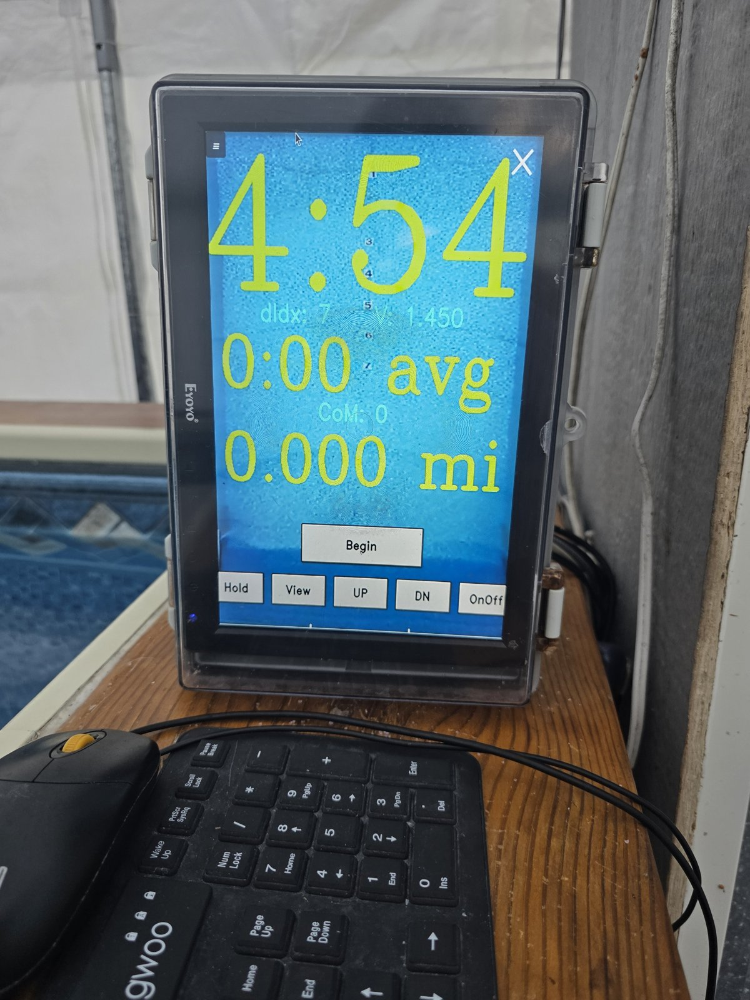

*The finished station beside the pool, PoolWind running: pace, average
pace and distance on the portrait monitor, with the waterproof keyboard
and mouse in front.*

## 2. Parts and tools

See the [parts list](../hardware/PARTS_LIST.md).

**Tools:** soldering iron and solder, wire cutters and strippers, a small
screwdriver set (to open the remote), a drill (for the remote's jack), and
a multimeter (for checking the Pace Display port voltage and the Y
splitter). Other tools are at the builder's discretion.

## 3. The Raspberry Pi

The Raspberry Pi is a small, inexpensive computer, about the size of a deck
of cards. It runs PoolWind, and everything else connects to it:

- the **camera** (USB): PoolWind watches the swimmer through it;
- the **interface board** (through the GPIO pins, below): PoolWind presses
  the remote's buttons with the relays, and reads the jet speed from the
  INA260 sensor;
- the **monitor** (HDMI): the pool screen, readable from the water;
- the **keyboard, mouse and swimmer's USB stick** (USB).

PoolWind is tested on a **Raspberry Pi 5 with 8 GB** of memory. (The
original 2021 build used a Raspberry Pi 4; the current version hasn't been
tested on one.)

### A starter kit is the easy way

Buy a Raspberry Pi 5 **starter kit** (parts list, row 1) rather than the
board alone. A kit includes the pieces that are easy to get wrong:

- **The official 27 W USB-C power supply.** The Pi 5 needs it. With a
  weaker supply it limits the power to its USB ports, and the camera or the
  USB stick can misbehave.
- **An active cooler** (a small fan and heatsink). PoolWind keeps the Pi
  busy, and at the poolside it's usually shut inside the station's closed
  box, so it needs one (see also the heat notes in
  [section 8](#8-the-poolside-station)).
- **A case** for the Pi itself: designed for air flow and ribbon cable pass through.
- **A micro-HDMI to HDMI cable.** The Pi 5's video ports are the small
  micro-HDMI size; the monitor takes ordinary HDMI.
- **A microSD card**, often with Raspberry Pi OS already on it.

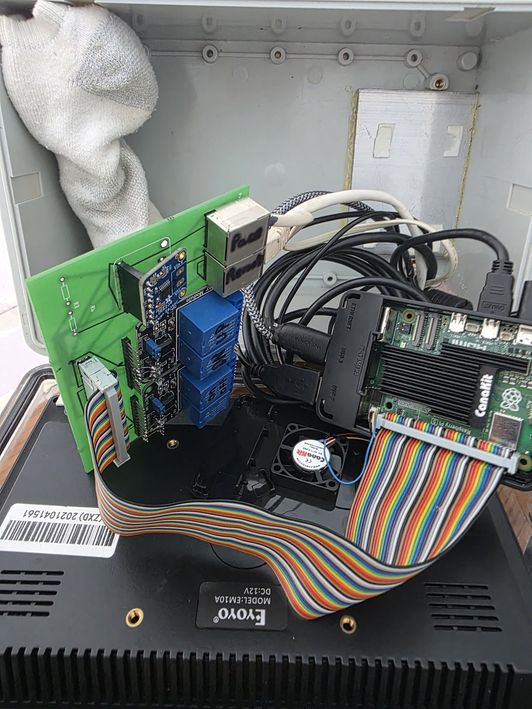

*The station opened up: the Pi in its starter-kit case (right), the
ribbon cable to the interface board (left), the case fan, and the
heatsink's flat side on the back wall of the waterproof case.*

### The SD card

The microSD card is the Pi's "hard drive": it holds the operating system
(Raspberry Pi OS), PoolWind and its settings. Ideally, use **32 GB or larger**; a
"high endurance" card lasts longest. However, the card that comes with a "kit" should be good enough.
Swims and videos normally go on each swimmer's own USB stick, not the card.

Keep a spare card, or a backup copy of the card, once PoolWind is set up:
if the card ever fails, you can be swimming again in minutes. Use the Raspberry Pi's own Accessories: SD Card Copier. Put a check mark on "New Partition UUIDs".

Preparing the card and installing PoolWind are covered step by step in the
[setup guide, sections 2 and 3](SETUP_GUIDE.md#2-preparing-the-sd-card).

### The GPIO pins

Along one edge of the Pi is a row of **40 pins**, the GPIO header ("general
purpose input/output"). Programs can switch these pins on and off, or use
them to talk to sensors. PoolWind uses a few of them:

- **three pins switch the relays** that press the remote's Up, Down and
  On/Off buttons;
- **two pins talk to the INA260** sensor (a connection called I2C);
- **power pins** (3.3 V and 5 V) supply the sensor, the relays and the
  remote.

A 40-pin ribbon cable connects the header to the interface board. The exact
pins are listed in [section 4](#4-the-interface-board), under "Connecting
to the Raspberry Pi". **Pin 1 must meet pin 1:** a cable plugged in the
wrong way round can damage the Pi.

### Ports

The Pi 5 has **four USB ports**, exactly enough for the camera, the
keyboard, the mouse and the USB extension for the swimmer's stick. Any
device works in any port. Its **network** (Wi-Fi or cable) is needed for
installing PoolWind and for [working from home](SETUP_GUIDE.md#9-working-from-home).

## 4. The interface board

The interface board connects the Raspberry Pi to the relays, the INA260
sensor and the two RJ45 connectors.

### Ordering the board

Upload [`hardware/gerbers/PoolWind_PCB_gerbers.zip`](../hardware/gerbers/PoolWind_PCB_gerbers.zip)
to any PCB maker. It's a standard two-layer board, 117 × 88 mm (4.59 × 3.46 in);
the maker's default settings are fine. The ZIP holds everything the maker
needs, including the **drill file** (`_drill.txt`, every hole's position and
size), so there's nothing to send separately. Check the maker's preview
before ordering: if the board shows no holes, the maker didn't recognize
the drill file. Rename it to end in `.drl` (for example
`PoolWind_interface_board_drill.drl`), zip the files again and
upload. The design itself is in
[`hardware/schematics/PoolWind_interface_board.fzz`](../hardware/schematics/PoolWind_interface_board.fzz);
open it in the free [Fritzing](https://fritzing.org) program to see the
layout.

### The wiring

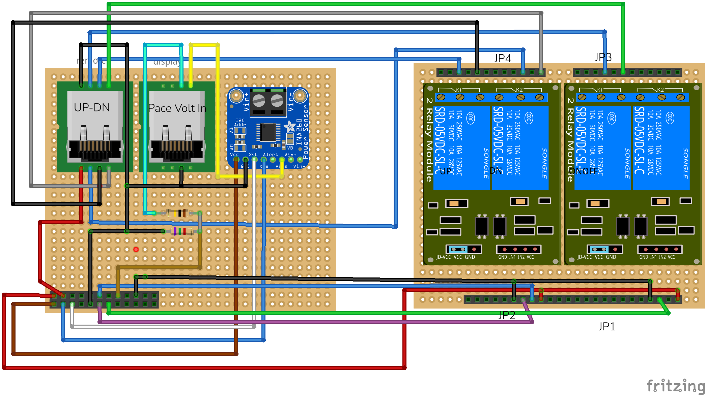

*The interface board's wiring, from the Fritzing design (breadboard view).
Left: the two RJ45 jacks, the Remote jack (UP-DN) and the Pace jack (Pace Volt In),
the INA260 sensor, the two resistors R3 and R6 (not needed, see below) and,
along the bottom, the header for the ribbon cable to the Raspberry Pi.
Right: the two 2-channel relay modules on headers JP1-JP4.*

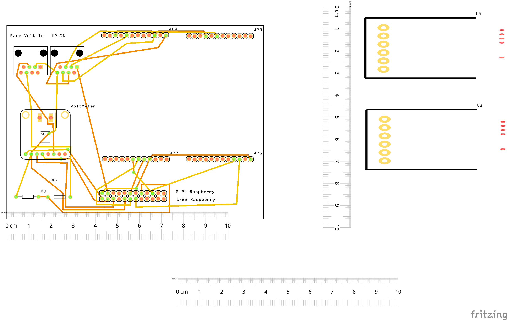

*The printed circuit board (PCB view), with rulers in centimeters: the RJ45
jacks, the Pace jack (Pace Volt In) and the Remote jack (UP-DN), top left, the INA260 ("VoltMeter") below
them, R3 and R6 bottom left, the Raspberry Pi header at the bottom, and the
relay headers JP1-JP4. The two relay modules (U3, U4, drawn to the right)
are separate boards, connected to headers JP1-JP4 with jumper wires.*

- **Relay module 1:** relay K1 = **Up**, relay K2 = **Down**.
- **Relay module 2:** relay K1 = **On/Off**, relay K2 = spare.
- **Headers JP3 and JP4** (top) carry the relay contacts to the
  Remote jack (UP-DN). **JP1 and JP2** (bottom) carry each module's GND, IN1, IN2 and
  VCC from the Raspberry Pi header.
- The relay modules' **JD-VCC jumper** stays fitted, so each module runs
  entirely from the Pi's 5 V.

- **Relay contacts:** each relay has its own two wires to the remote, and
  closing the relay connects them, just like pressing the button. Up:
  NO to pin 3, COM to pin 6. Down: NO to pin 4, COM to pin 2. On/Off: NO
  to pin 5, COM to pin 7 (pins of the Remote jack). The **NC** contacts
  aren't used.

### Assembling it

There's no special soldering order: the only delicate part, the INA260
sensor, plugs in afterward.

1. **Resistors R3 and R6: leave them out.** They form a voltage divider
   for detecting whether the pool is on, from the Pace Display port's
   38 V power line, which PoolWind doesn't use. If you ever fit them,
   use **R6 = 100 kΩ and R3 = 7.5 kΩ** (about 2.7 V at GPIO 23). Lower
   values would destroy the Raspberry Pi's GPIO pin.
2. **Headers:**
   - Ribbon cable to the Pi: **male header pins, 2 × 12** (the cable's plug
     is female).
   - Relay headers JP1-JP4: **male header pins, 1 × 12** each (see item 5).
   - INA260: a **1 × 8 socket strip**, so the breakout plugs in and out.
3. **The two RJ45 jacks:** the Pace jack (Pace Volt In), from the pool's
   Pace Display port, and the Remote jack (UP-DN), to the remote. The
   author used jacks from an RJ45 breakout kit (parts list, row 8),
   soldered straight onto the board without their small breakout boards.
4. **The INA260 breakout:** prepare it, then plug it into its socket strip.
   - **Cut the VB jumper** on the breakout: the jumper connecting **V+** to
     **VBUS**. It's there for measuring the current in a power line.
     Cut, the VBUS pin measures only the voltage brought to it: the
     jet-speed voltage from the Pace jack. This turns the breakout from a
     current sensor into the voltage sensor PoolWind needs.
   - **Leave the address jumpers (A0, A1) open.** PoolWind looks for the
     INA260 at its default address, 0x40.
   - Solder on its header pins (they usually come loose with the breakout).

5. **The relay boards:** two 2-channel relay modules with 5 V relays (for
   example JQC-3FF-S-Z or SRD-05VDC-SL-C), powered from the Raspberry Pi's
   5 V through the board. Solder **male pin headers** into JP1-JP4. On the
   control side (JP1, JP2), solder short, stiff wires from the header pins
   to the relay modules' input pins: these wires also hold the modules in
   place on the board. On the contact side (JP3, JP4), solder the wires to
   the header pins and clamp their other ends in the relay modules' screw
   terminals.

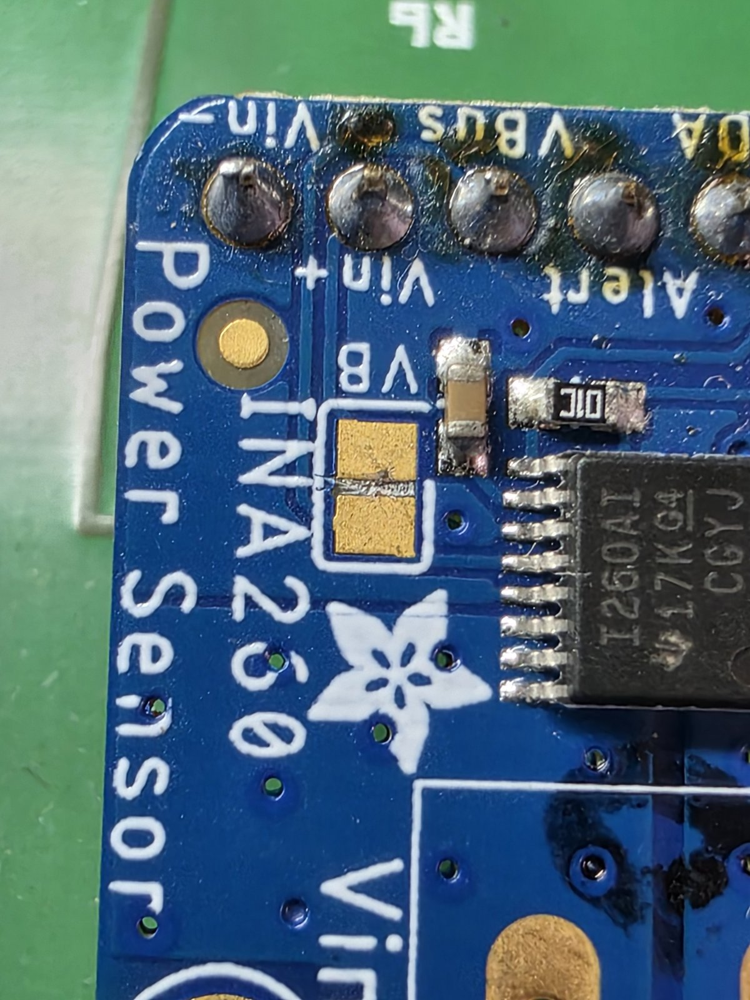

*The INA260 breakout's **VB** jumper, cut: the two gold pads in the box
marked "VB" are separated by a scratch across the thin trace between
them. Cut it with a sharp craft knife and check with a multimeter that
V+ and VBUS are no longer connected.*

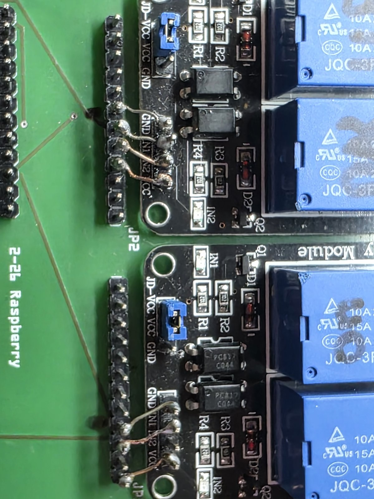

*The control side: short, stiff wires from the JP1 and JP2 header pins
to each relay module's GND, IN1, IN2 and VCC pins. They also hold the
modules in place. The blue JD-VCC jumpers stay fitted.*

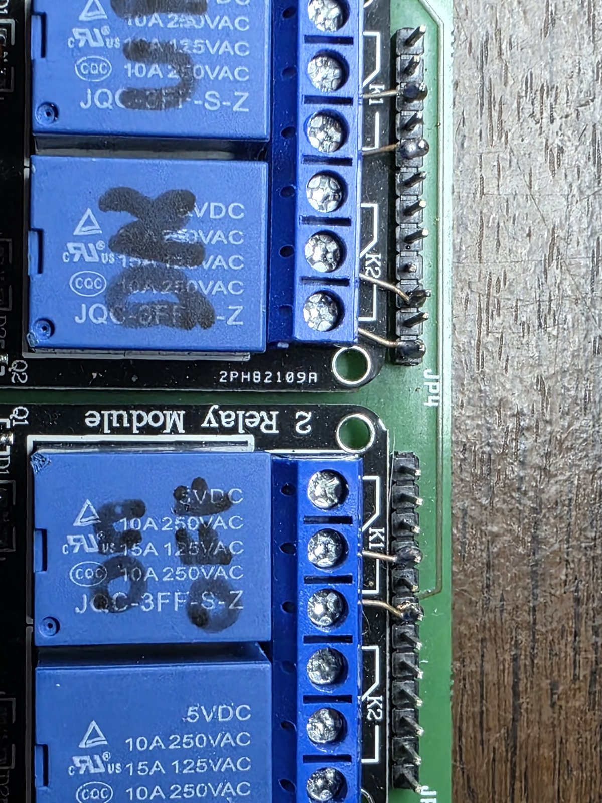

*The contact side: wires from the JP3 and JP4 header pins, clamped in the
relays' screw terminals (COM and NO of each relay used). The relays are
marked by hand: Up, DN and On/Off. The second module's K2 is the spare.*

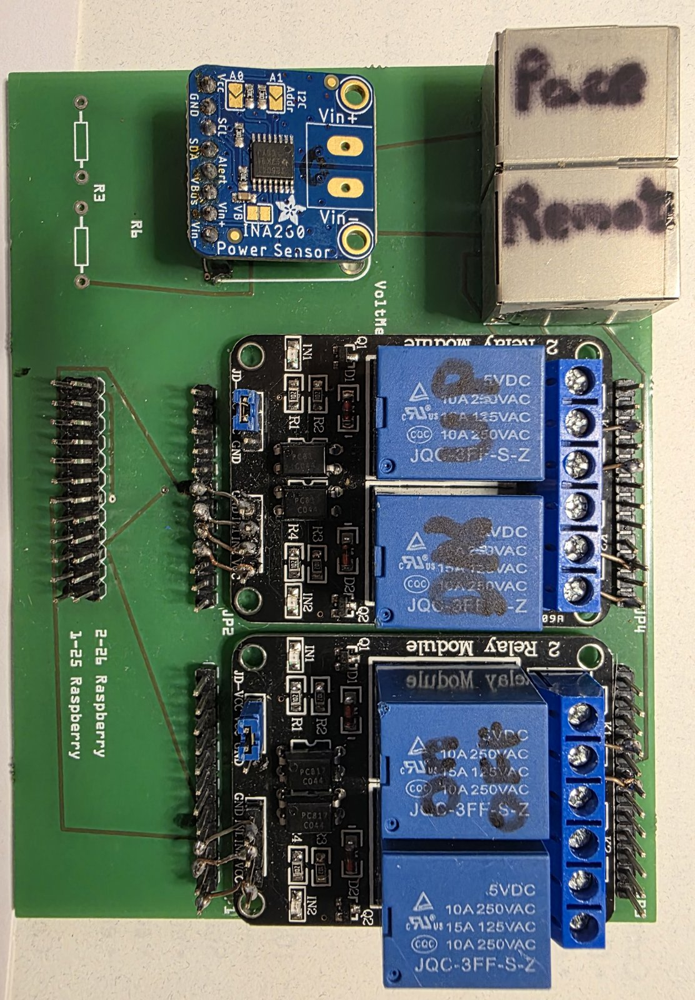

*The author's finished interface board. Top: the INA260 sensor, with the
empty places for R3 and R6 to its left, and the two RJ45 jacks, labeled
"Pace" and "Remote" on this first-batch board (boards made from the
current Gerber files print "Pace Volt In" and "UP-DN"). Below: the two relay modules (Up and Down on the first,
On/Off on the second) wired to the board's headers, and the Raspberry Pi
header on the left.*

*This is the author's own board, from an early batch that was corrected
and updated by hand. The photo shows an earlier version of the board.
Boards made from the current Gerber files need no changes.*

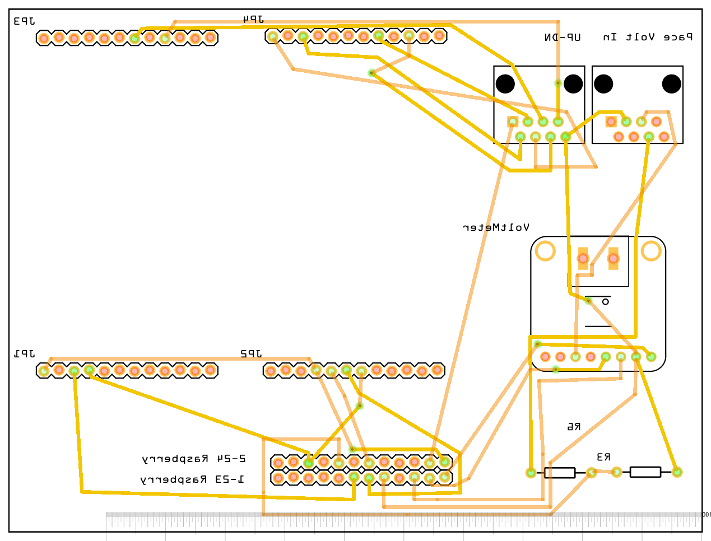

*The board seen from below (Fritzing PCB view): the bottom layer's copper
is drawn bright, the top layer's faded.*

### Connecting to the Raspberry Pi

A standard **40-pin GPIO ribbon cable** (female plugs at both ends) plugs
onto all 40 of the Raspberry Pi's GPIO pins.

**Mind the orientation:** pin 1 on the board must meet pin 1 on the Pi.
A cable plugged on the wrong way round can damage the Pi.

**Hint:** Looking at the Raspberry board with the GPIO header strip (close
to the edge of the board) toward you, Pin 1 is on the right side top. You
may see small text directly next to it: J8. If you place the Interface
board edge to edge where the two GPIO sets are closest to each other,
you'll see the two GPIO sets line up pin for pin on the lower 24 of the 40
pins. Connect the ribbon cable there making sure Pin 1 on each header is
connected to each other. The higher Pin numbers of the connector just hover
over the empty space on the Interface board.

The pins PoolWind uses:

| Pin | Use |
|---|---|
| 1 (3.3 V) | INA260 power |
| 2 (5 V) | Relay modules' power (VCC) |
| 3 (GPIO 2, SDA) and 5 (GPIO 3, SCL) | I2C to the INA260 |
| 4 (5 V) | Remote jack (UP-DN), pin 1: powers the remote |
| 9 (ground) | INA260 ground, both RJ45 jacks' ground |
| 11 (GPIO 17) | Relay: jet speed Up |
| 12 (GPIO 18) | Relay: jet speed Down |
| 13 (GPIO 27) | Relay: pump On/Off |
| 16 (GPIO 23) | Pool-on detection (R3/R6 divider), not used |
| 20 (ground) | Relay modules' ground |

### The RJ45 jacks

| Jack | Pin | Connection |
|---|---|---|
| Pace jack (Pace Volt In) | 5 | Jet-speed voltage from the Pace Display port, to the INA260's VBUS input |
| | 3 | Ground |
| | 6 | Pace Display power, 38 V, to the pool-on detection (R6), not used |
| Remote jack (UP-DN) | 3 and 6 | Up button (Up relay's NO and COM) |
| | 4 and 2 | Down button (Down relay's NO and COM) |
| | 5 and 7 | On/Off button (On/Off relay's NO and COM) |
| | 1 | 5 V: powers the remote (it has no battery) |
| | 8 | Ground for the remote's power |

## 5. The remote

PoolWind presses the buttons of an Endless Pools **EP1** water-resistant
remote. Two come with the pool: modify one and **keep the other unmodified**
for controlling the pool by hand.

Soldering to a remote will probably void its warranty.

The modified remote **gets its power from PoolWind** through the cable, not
from its battery. The EP1 normally runs on two CR2032 coin cells in series,
about 6 V when new (5.86 V measured on the author's spare remote), so the
Raspberry Pi's 5 V is a little below its usual battery voltage. The
author's remote has worked reliably on it.

Inside, the author's EP1 is a Martec Access Products "3 Button
Transmitter" circuit board (model BT-433M, 433.92 MHz). Another remote with
the same board should work the same way.

1. Open the remote (four small screws) and **remove the battery.**
2. **Fit an RJ45 jack to the back of the remote.** The author used a small
   8-pin "RJ45 breakout" board, from the same kit as the board's jacks:
   drill a hole through the case for each of its pins and push the pins
   through from outside. The holes break the remote's water resistance,
   so the remote goes **in a watertight box** (step 6).
3. **Inside, solder a wire from each pin to its contact** on the remote's
   circuit board. The author used short lengths of the thin wires from a
   cut Cat6 cable. Positions are with the circuit board turned so that its
   "3 BUTTON TRANSMITTER" label reads along the top:

   | RJ45 pin | Wire color (author's) | Contact | Where |
   |---|---|---|---|
   | 1 | orange | Battery + terminal (5 V) | right edge, halfway down |
   | 3 | white/green | Up (faster) button, one side | bottom-left button, right side |
   | 6 | green | Up button, other side | bottom-left button, left side |
   | 4 | blue | Down (slower) button, one side | bottom-right button, left side |
   | 2 | white/brown | Down button, other side | bottom-right button, right side |
   | 5 | white/blue | On/Off button, one side | center button, left side |
   | 7 | white/orange | On/Off button, other side | center button, right side |
   | 8 | brown | Battery ground terminal | lowest solder point on the right |

   Each button gets its own two wires, and its relay connects them, just
   like pressing the button.

   The pin numbers match the interface board's Remote jack (UP-DN), so an ordinary
   **straight-through network cable** (Cat5e or Cat6) connects the two
   jacks. No special cable or crimping is needed.

   **If your remote is different,** find each of its three buttons' two
   contacts (a multimeter shows them connected while the button is held
   down) and wire them to the same pins. Ask in the project's Discussions
   if you're unsure.
4. **Make sure a battery can't be put back in**, for example by covering or
   blocking the battery compartment (the author used two small blocks of
   foam mounting tape). A battery and the 5 V supply together could
   damage the remote or the Raspberry Pi.
5. Close the remote.
6. **Put it in a watertight box.** Any small clear plastic box will do;
   the author's is a spare one: a hole drilled in one end, just large
   enough for the cable's plug, sealed around the cable with silicone
   putty, and electrical tape all around the seam between the box and its
   lid. Two small bags of desiccant inside keep it dry. With the cable
   coming out of the bottom, water runs off instead of collecting at the
   hole. Mount the box within radio range of the pool's controller; the
   author's is about 15 ft (4.5 m) away.

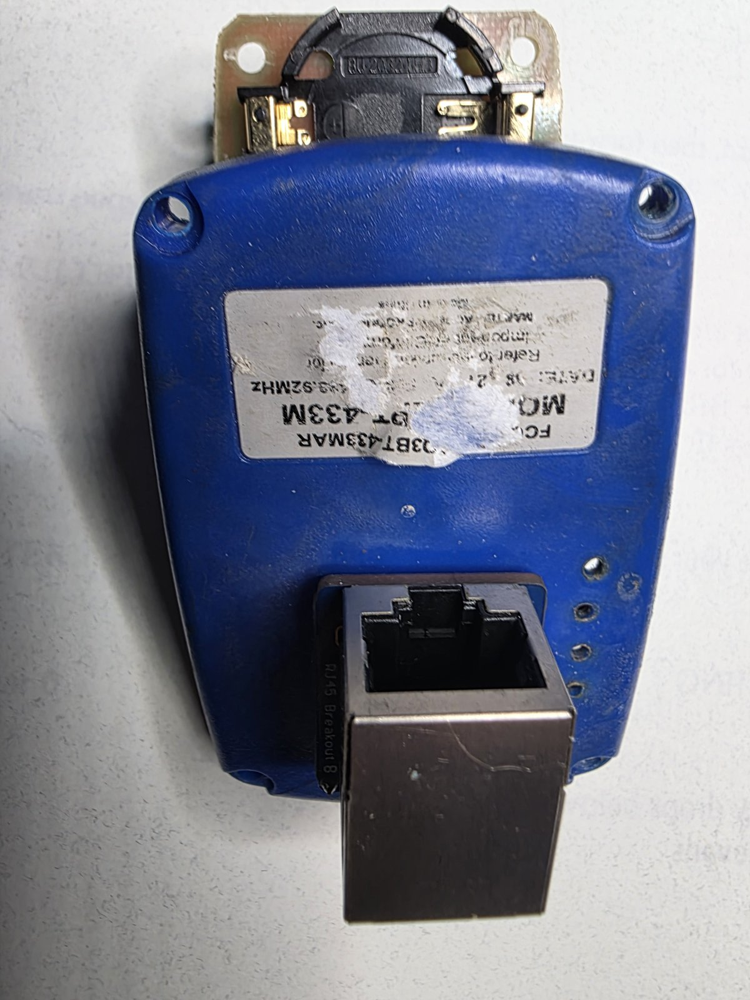

*The RJ45 breakout mounted on the back of the remote. The row of four holes
beside it is left over from development (a relay that switched a laser on
while the jet speed was changing, so the author could see it while
swimming). A remote modified for PoolWind doesn't need them.*

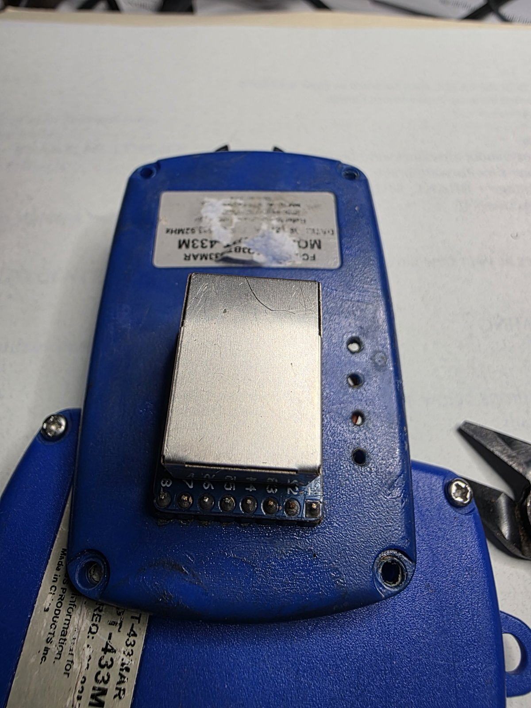

*The breakout's eight pins, numbered 1 to 8, pushed through holes drilled
in the case.*

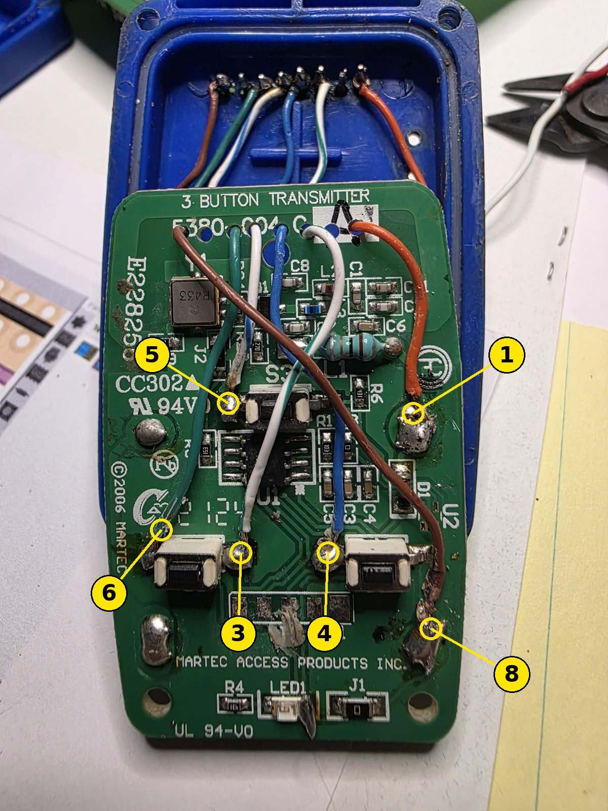

*Inside the author's modified EP1 remote. The wires run from the RJ45
breakout's pins (top) to the contacts on the circuit board; each solder
point is marked with its RJ45 pin number, as in the table above.*

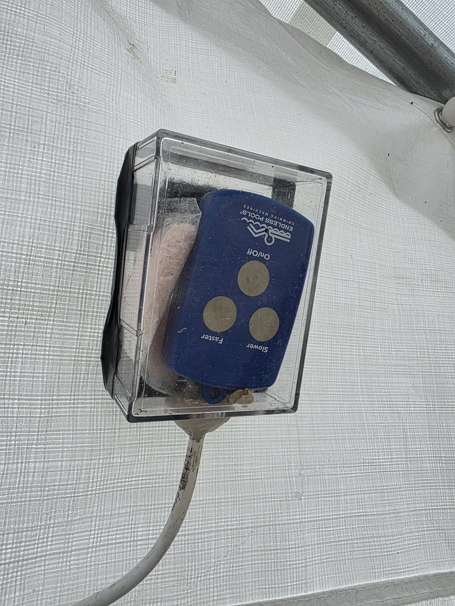

*The author's remote in its box, about 15 ft from the pool's controller:
electrical tape around the lid, putty where the cable comes in at the
bottom, and a bag of desiccant beside the remote.*

When the Raspberry Pi powers up, the remote's light flashes a few times.
If the remote doesn't control the pool, pair it with the pool's controller
as the pool's own manual describes (on the author's pool, that takes
pressing a small button on the pool controller). The modified remote only
works while PoolWind's hardware is powered; the unmodified remote is for
manual control.

## 6. The Pace Display port

The pool's control box has a port for the manufacturer's optional Pace
Display. It carries 38 V power, ground, and one line whose voltage changes
steadily with the jet speed: the same jet speed always gives the same
voltage. It is probably the voltage that controls the hydraulic valve.
PoolWind reads it through the board's Pace jack (Pace Volt In) and the
INA260 sensor.

On the author's pool controller there is only one port a phone plug fits
into, on the bottom left edge of the controller: use that one.

Connect it with a **phone cable** (6-position plugs), long enough to reach
from the pool's controller to the interface board. The author's cable
has only the center four wires (a 6P4C or RJ14 cable), which is all the
board needs; a 6-wire cable (6P6C, sometimes sold as RJ25 or RJ12) works
too. The phone plug is smaller but fits the board's 8-pin RJ45 jack: its
six contacts land on the middle six pins of the jack.

The board uses two of the wires: the pool's ground and the jet speed
voltage.

**Note:** this is the only ground connection between the pool and the
interface board. It is not a safety ground (see [SAFETY.md](../SAFETY.md));
it is used only as the reference for the jet speed voltage.

| Phone plug contact | Interface board's Pace jack pin | Use |
|---|---|---|
| 2 | 3 | Ground (the Raspberry Pi's ground) |
| 4 | 5 | The jet speed voltage, to the INA260's VBUS pin: about 1.2 V to 3.2 V, always present |
| 5 | 6 | Not used (goes to R6, which is left out): about 38 V when the pool pump is powered up |

The other contacts aren't connected on the board.

### Check the cable voltage

Phone cables come in two kinds: straight-through cables connect each
contact to the same contact at the other end, and "reversed" cables
(common for telephones) swap them end for end (1 to 6, 2 to 5, 3 to 4).
The author's cable is straight-through. With a reversed cable, the 38 V
line and ground trade places, which is why this check is done with
nothing else connected:

1. Plug your cable into the pool controller's port (or wire it in if you
   have to) and into the interface board's Pace jack. The board needs only
   the Pace jack soldered in for this. **Don't plug in the INA260, and
   don't connect the ribbon cable to the Raspberry Pi.**
2. On the back of the board, put the multimeter's ground probe on the
   Pace jack's pin 3 and the other probe on pin 5. It should read a small
   positive voltage, 1.2 V to 3.2 V. On the author's pool this voltage is
   always present: the pool doesn't need to be turned on.
3. Use the spare remote to raise the jet speed: the voltage should rise.
   Lower the jet speed: it should fall.

**Essential: if the small voltage isn't present on pin 5, or it doesn't
change with the jet speed, PoolWind will not work.** It is the feedback
that tells PoolWind what its remote button presses did.

You could also check pin 6, but it isn't needed, as pin 6 isn't currently
used. On the author's pool it shows about 38 V, only while the pool pump
motor is turned on.

### If you have a Pace Display

If you have a working Pace Display, connect the interface board through a
**Y splitter** so both stay plugged in: a short phone cable from the port
to the splitter, then the Pace Display and a longer phone cable to the
interface board. All three cables should be straight-through.

**Choose the splitter carefully.** Use a splitter that connects every wire
straight through to both legs, and check it with a multimeter before
connecting it to the pool.

**Seal the splitter and the Pace Display** in a case with desiccant bags.
Use any method that works. The author's own Pace Display was ruined by
corrosion from the moist, chlorinated air.

## 7. The camera

The camera selected for this is wide angle with a 120 degree view, chosen so it can see the entire swim area of the pool without being mounted too high.

- **Mounting position:** this depends on your pool, so there's no single
  right way. However it is mounted, the camera must see the whole swim area, between the benches, from the back to the front of the pool. Make plans so the camera will be about 5 to 6 feet above the pool but be flexible, the distance may have to be adjusted. See the setup guide, [section 5.1 (The swim area)](SETUP_GUIDE.md#51-the-swim-area), to help you place the camera correctly.
  Placement isn't critical, any image outside this area is trimmed out.
  Also it is not essential that the camera is mounted exactly in the center point of the pool, still the closer the better. PoolWind has perspective correction which visually moves the camera to the center but distorts the objects it sees. The camera could hang off the ceiling or be mounted on poles from the side and brought in toward the center. The mount should be sturdy though because you don't want the camera to shake. 
  
  
- **Cable:** a 10 ft USB extension reaches the Raspberry Pi. A longer run
  may need an active (repeater) USB extension.

- **Lighting:** see the README's notes on lighting and outdoor pools.

## 8. The poolside station

The Raspberry Pi, the control interface board, and the monitor sit together in a waterproof case with a clear door, beside the pool. The case used worked perfectly although the clear door came with an injection-molding spot right in the middle that was not polished down. Polishing with a Dremel tool worked but was tedious and the plastic tried to melt. 

Build as you see fit. For instance, the Raspberry Pi could sit further away from the pool and the monitor and mouse could be at the pool's edge. **Emphasizing waterproof** Or find a waterproof touchscreen: that would be ideal if there is such a thing. You could use two monitors and set up a work station further away from the pool (the Raspberry Pi has two HDMI ports).
The keyboard is rarely used and is not needed at the pool edge. It is used for changing default settings, setting up the USB stick, for moving or deleting files, and general computer stuff. 

**Please read [SAFETY.md](../SAFETY.md) first.**

- **Monitor:** the 10-inch Eyoyo only just fits the case, partially within the clear door. Its control buttons had to be removed. Mount it in **portrait** mode (taller than wide).

- **Keyboard and mouse:** waterproof, USB.

- **Heat:** a closed waterproof case traps heat. For swimming alone this
  was no problem: the author turns the Raspberry Pi off between swims. It
  overheated only when left running on a hot summer's day. The fix that
  works all the time is a large heatsink (about 3 × 4 in) mounted in a
  hole cut in the case wall and sealed, with its fins outside and its flat
  side inside. The Raspberry Pi is placed so it draws its air from near
  the heatsink.

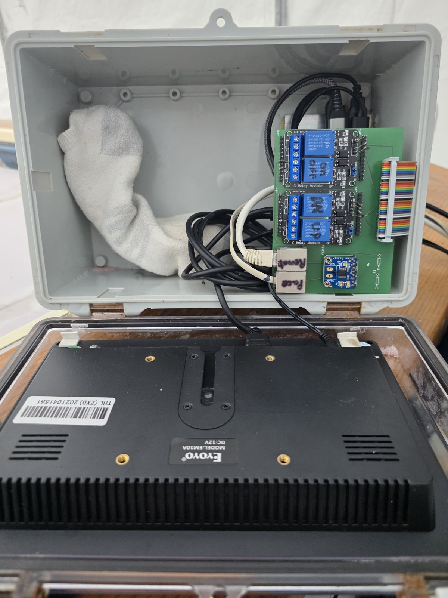

*Everything tucked in. The Pi sits behind the interface board, against
the heatsink's inside face; the fan at the back of the Pi's case draws air
from right beside the heatsink and blows it over the chips. Cables are
kept away from the Pi case's air vents. The monitor is mounted in the
clear front door, and the sock is full of desiccant packs.*

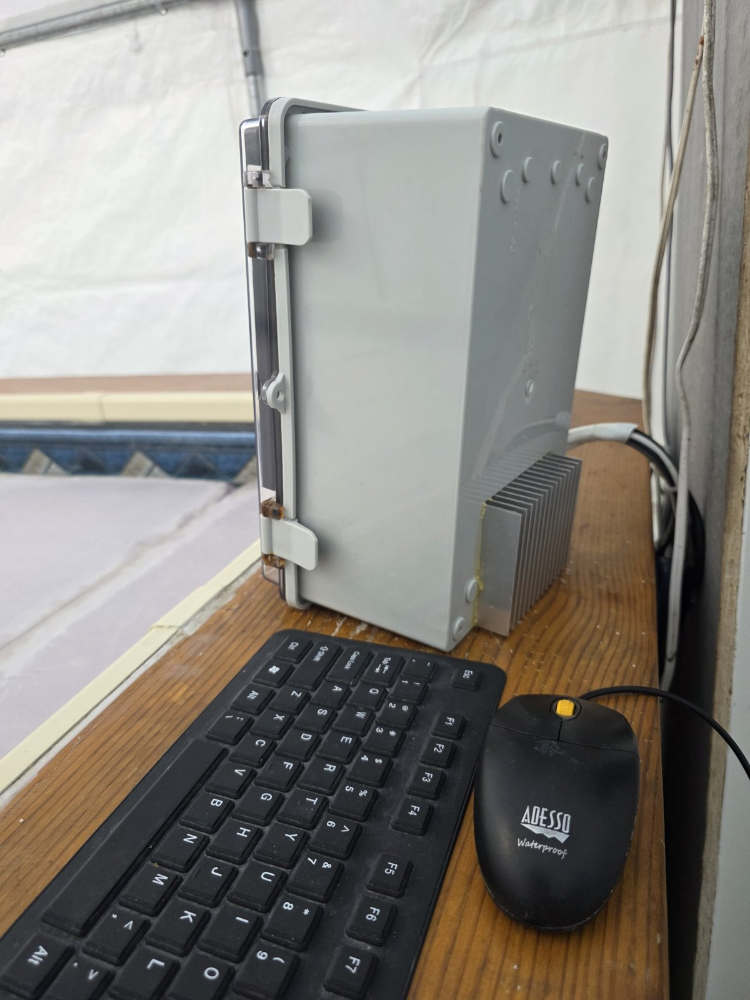

*The closed case from behind: the heatsink's fins outside, sealed into
the case wall.*

- **Power:** a proper power supply for the Raspberry Pi and one for the
  monitor, plugged into a **GFCI-protected outlet** away from splashing
  water. Only use the low voltage cables, never run 125V power anywhere near the pool!

- **Cabling:** many cables run out of the case: two low voltage power cables (Raspberry Pi and monitor), keyboard, mouse, camera, remote control, pool voltage feedback, and USB (for the user's USB stick) cables. Bundle them, and seal them where they leave the case with waterproof cable glands. Let each cable sag in a drip loop below the case, so water runs off instead of following the cable in. The USB extension lets the swimmer plug in their USB stick outside the closed case.

## 9. First power-up checks

Before connecting anything to the pool:

1. **Check the wiring** against the board, especially the ribbon cable's
   orientation.
2. **Power up the Raspberry Pi** and install the software (setup guide,
   section 3).
3. **Setup the camera** 
   To see what the camera sees, use the Raspberry Pi VLC Media Player and select 'Open Capture Device' -> 'Video Device Name' -> '/dev/video0' -> 'Play'. You should orient the camera so that it displays the pool with the **pool front to the left**. Don't try to correct the orientation with the program. Once you see the entire swim area in view you're done.
4. **Check that the INA260 is found:** in a terminal, `i2cdetect -y 1`
   should show `40` in its table.
5. **Check the On/Off relay clicks**, with the remote not yet connected:
   start PoolWind and press **OnOff**. You should hear one short click.
   The Up and Down relays are checked once everything is connected (step
   6): without the Pace Display cable PoolWind reads no voltage and, for
   safety, won't press Down.
6. **Connect the remote and the Pace Display cable**, then check that **the
   jet answers** (setup guide, [section 4](SETUP_GUIDE.md#4-first-start)):
   with nobody in the pool, press **Hold**, then **UP** and **DN** a few
   times, and watch the jet change one step per press. Continue with
   calibration in the [setup guide](SETUP_GUIDE.md).
