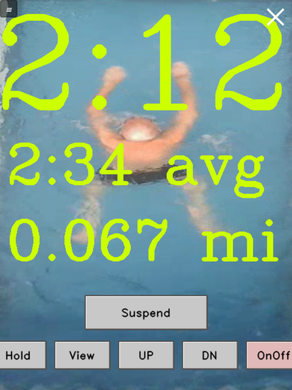
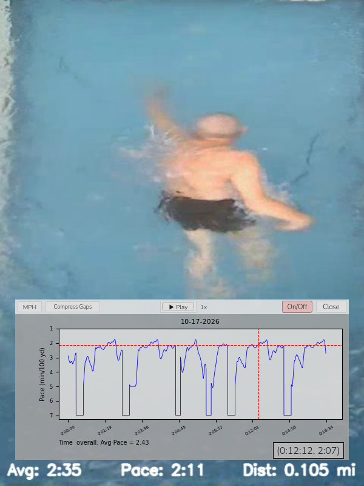

# PoolWind User Manual

This manual is for swimmers. Building PoolWind and setting it up for your
pool are covered in the build guide and the setup and calibration guide.

**Please read [SAFETY.md](../SAFETY.md) first.**

## Contents

1. [Before you swim](#1-before-you-swim)
2. [Starting PoolWind](#2-starting-poolwind)
3. [The pool screen](#3-the-pool-screen)
4. [Swimming with PoolWind](#4-swimming-with-poolwind)
5. [Finishing a swim](#5-finishing-a-swim)
6. [Your USB stick](#6-your-usb-stick)
7. [Reviewing your swims: Swim Plot](#7-reviewing-your-swims-swim-plot)
8. [Your settings](#8-your-settings)
9. [The demo tour](#9-the-demo-tour)

---

## 1. Before you swim

- **Use your own USB stick.** It holds your personal zone limits (your
  slowest and fastest zone), so the jet never goes faster than you've
  chosen. Never use someone else's stick,
  especially a stronger swimmer's.
- **Insert your stick before starting PoolWind.** A stick inserted while
  PoolWind is running isn't used until the next start.
- **Know how to take manual control:** press **OnOff** to wind the jet down
  and stop the pump, or close PoolWind (see
  [Finishing a swim](#5-finishing-a-swim)) and use the pool's own remote.
  Closing PoolWind doesn't slow the jet. While PoolWind runs, it fights
  against any change the pool's own remote makes.
- **Take any pool cover off before starting PoolWind,** and close PoolWind
  before putting it back on. A cover changes what the camera sees: PoolWind
  may take part of it for a swimmer and adjust the jet when nobody is
  swimming.

## 2. Starting PoolWind

1. Insert your USB stick.
2. Start PoolWind with its **desktop icon**. 
3. The pool screen appears. Press **Begin** (or **Resume**, see below) when
   you're ready to swim. Until then, the jet stays at its lowest setting.

**Begin or Resume?** If you've already swum today, the big button says
**Resume** (in red) instead of Begin. Your swim continues where it left off:
today's distance and average Pace carry on from your earlier session.

**DEMO on the screen?** PoolWind is set up as a demo and doesn't control
the jet. Ask whoever set it up. To follow the recorded swim, see
[The demo tour](#9-the-demo-tour).

**A blank or new USB stick?** PoolWind offers to set it up as a new
swimmer's stick (see [Setting up a new stick](#setting-up-a-new-stick)).

**"Camera moved?"** A few seconds after the start, PoolWind checks that the
camera still sees the pool the way it did when the swim area was set. If
it has moved (knocked, or moved for cleaning), PoolWind asks. Choose
**Adjust** to move the swim area with the picture, unless you know better:
**Keep** leaves it (it asks again next time), **Set Swim Area** lets you
set the corners yourself. If it says **Check the camera**, the camera has
moved too far, or the picture isn't the pool it knows: put the camera back
(or ask the person who set it up) before swimming.

## 3. The pool screen

The screen shows the camera's view of the pool swimming area from above, with your
numbers on top in large letters you can read from anywhere in the pool.



**Your numbers:**

| On screen | Meaning |
|---|---|
| Large Pace at the top (e.g. `2:15`) | Your **Swimmer Pace**: your estimated Pace through the water, in minutes per 100 yards |
| `2:31 avg` | Your average Pace so far today |
| `0.512 mi` | Distance swum today, in miles |

**Buttons:**

Most buttons are labeled with what they'll do when you press them. Two of
them also change color to warn you that PoolWind isn't running normally:
**Hold** turns yellow and **Suspend** turns red.

| Button | What it does |
|---|---|
| **Begin** (large, center) | Starts the day's first swim. Then it says **Suspend** |
| **Suspend** | Pauses your swim. Then it turns red and says **Resume**. See [Pausing](#pausing-suspend-and-resume) |
| **Resume** (red) | Continues your swim |
| **Hold** | Keeps the jet constant, wherever you are in the pool. The button turns yellow and says **Vary**. See [Hold](#hold-a-steady-jet) |
| **Vary** (yellow) | Shown while Hold is on. Use **UP** and **DN** to vary the held speed, and press **Vary** to go back to automatic control |
| **View** | Switches between the camera view and three detection views (see below) |
| **UP / DN** | In Hold mode, raise or lower the held speed, one jet step per press |
| **OnOff** (light red) | Turns the pool's pump on or off, at one touch. The jet winds down first (see [OnOff](#onoff-the-pump)) |
| **≡** (top left) | Menu, in the order things are set up: **Set Swim Area...**, **Calibrate pool...** and **Pace correction...** (the pool's calibration, for the technician), **Swimmer limits...**, then **Swim Plot...** |
| **X** (top right) | Closes PoolWind |

A button looks pressed in while you touch it.

**The View button** cycles through four views. The first is the normal
camera view. The other three show what the camera's swimmer detection
sees, in black and white. They help when checking that PoolWind is
detecting you properly. Press View until the camera view returns.

**Tap the picture** (anywhere off the buttons) to light up the zone that
matches the jet's speed and show the lines between the zones; tap again to
turn them off. See
[Seeing the jet's zone](#seeing-the-jets-zone-the-zone-highlight).

## 4. Swimming with PoolWind

### How the jet follows you
PoolWind divides the pool into **zones** from back to front. Each zone has
its own jet speed, slowest at the back and fastest at the front.

- **Speed up**, and you move forward into a faster zone. The jet speeds up
  until it balances your faster stroke.
- **Ease off**, and the jet pushes you back into a slower zone, where it
  relaxes again to balance your slower stroke.
- **Swim steadily**, and you settle in one zone with a steady jet flow.

Your slowest and fastest zone are set on your USB stick (see
[Swimmer limits](#swimmer-limits-your-slowest-and-fastest-zone)), so the jet
never goes faster than your fastest zone.

You can change strokes, speed up, and slow down to rest without running into
the front or the back of the pool. But a **sprint** will put you into the wall.
Delays in jet response and changing the momentum of the large volume of water 
take a few seconds. Give the system a little time to work.

### Seeing the jet's zone: the zone highlight

**Tap the picture** (anywhere off the buttons) to light up the zone that
matches the jet's speed right now, as a faint band across the screen, with
thin yellow lines between all the zones. Tap again to turn them off. They
are turned off when PoolWind starts.

- The band is the **jet's** zone, not yours: It is not a physical zone but it represents the rate the water is moving.  You can think of the band as the readout of a jet speed meter, slowest at the bottom of the screen (the back of the pool), fastest at the top.
  For how the zones work, see
  [PoolWind in brief](../README.md#poolwind-in-brief) in README.
- It stays put while the jet holds a speed, so it's a **stationary
  reference**: you can see a stronger or easier stroke carry you forward or
  let you drift back against it.
- It moves as soon as the jet changes speed, a moment after you move. The
  water then takes a few more seconds to catch up. Those delays are why a
  sprint can run you into the wall: you can watch it happen.
- Don't blame the program for the slow movement of the band: it only reflects built in pool delays of setting the jet speed (moving the valve). Moving the mass of the water takes a few seconds more. Nothing can speed that up.

The same tap works on the video in [Swim Plot](#7-reviewing-your-swims-swim-plot).

### swimArea definition
**swimArea** is the swimming area of the pool that does not include the water return benches. Its four corners are marked using the menu item: (**≡**, top left)  **Set Swim Area...** (see [The swim area](SETUP_GUIDE.md#51-the-swim-area) in the setup guide). Everything else the camera might pick up is cut out of the swimArea and discarded. The swimArea is what you see on the monitor.

### swimZone definition
**swimZone** is a subset of the swimArea and is a lateral zone down the middle of the pool that has a width of 35% (as shipped) of the swimArea. It's a "zone" because PoolWind only responds to swims occurring in the swimZone.

### dataTracking definition
**dataTracking** refers to a set of operations that consists of:
- compute and display distance swum
- compute and display average Pace
- record video taken of the swimArea including the swimmer
- record swim data synchronized with the video including Pace, averagePace, and distance
This set can be turned on or off as a whole. When "on", the latest data is displayed and sent to the USB stick (or on the SD if there is no stick). When "off", computation and recording stop, leaving latest values frozen on the monitor (Pace, however, still updates). When "on" again, data is appended, not destroyed.

### Swim down the middle in the swimZone
PoolWind turns on dataTracking only if you are in the swimZone but allows you to deviate in and out with no problem.

- if you leave the swimZone and stand next to it, dataTracking is suspended and the jet winds down to its lowest setting after a few (3) seconds
- if you leave the pool and the camera can't see you, dataTracking stops within a fraction of a second, and the jet starts winding down at once, stepping down to its lowest setting over several seconds (there's no 3-second wait)
- if you stop moving in the swimZone (standing or floating), after 15 seconds PoolWind treats you as gone and the jet winds down; after 3 more minutes it presses **Suspend** by itself (the button turns red)
- dataTracking is re-enabled when you re-enter the swimZone

### Pausing: Suspend and Resume

Press **Suspend** to take a break. 
- dataTracking stops
- the jet winds down to its lowest setting. 
- the button turns red (easy to spot while swimming) and says **Resume**
- press **Resume** to continue your swim and return back into the swimZone

As mentioned directly above, leaving the swimZone also suspends dataTracking but pressing the "Suspend" button will not allow dataTracking to resume if you re-enter the swimZone.

### Hold: a steady jet

Press **Hold** to adjust the jet flow to a constant level.
- you had already left the swimZone to reach the monitor and mouse
- data tracking had stopped
- the jet probably had or will soon have wound down to its lowest setting
- the button turns yellow and says **Vary**, an easily seen reminder that the jet is no longer following you
- immediately the jet will start to increase its flow to where it was when you exited the swimZone
- press and hold **UP** or **DN** to vary the jet flow as indicated by the Pace display

When you return back to the swimZone:
- the jet flow will not vary
- dataTracking resumes

Press **Vary** to go back to automatic control. 
- you had already left the swimZone to reach the monitor and mouse
- data tracking had stopped
- the jet winds down to its lowest level 
- PoolWind runs normally

Note that if a coach is pressing the buttons for you and you remain in the swimZone, the jet flow will not wind down and dataTracking remains active. 

Hold is useful for drills or steady-Pace training. Remember that in Hold,
the jet doesn't slow down if you fall back, get out of the swim zone, or even leave the pool.

### OnOff: the pump

**OnOff** turns the pool's pump on or off, the same as the button on the
pool's remote. PoolWind first winds the jet down to its lowest setting
(**"Winding the jet down before switching the pump…"**), then switches the
pump, so you feel the jet slow down before it stops, and it always starts
slow. PoolWind stops adjusting the speed while it does this, giving OnOff
top priority.

**In an emergency**, press **On/Off now** in that message: the wind-down
stops and the pump is switched at once.

### Pace correction: when the Paces don't feel right

Pace is only an estimate (body type, stroke, how deep you swim). If the
Paces PoolWind shows don't match Paces you know from a regular pool,
correct them once for the pool:

1. Open the menu (**≡**) and choose **Pace correction...**. A small box
   opens over the pool screen; drag it out of the way if you like.
2. Swim until the current feels like a Pace you know, then move aside. The
   box shows the Pace PoolWind reads for that speed.
3. Type the Pace it should be (`1:45`, or just `145`, on the keyboard or the
   box's number pad) and press **Add**.
4. Do it again at other speeds: slow, medium, fast. Then press **Save**.

After saving, each of those speeds shows the Pace you typed; between them
the correction is blended, and past the slowest and fastest it carries on
the same way. Only the Paces shown change, not the jet speeds or anyone's
zones. Use one correction for everyone who swims in this pool, so swimmers
can be compared.

## 5. Finishing a swim

> **Close PoolWind before putting on a pool cover.** A cover changes what
> the camera sees, and PoolWind may take part of it for a swimmer and adjust
> the jet when nobody is swimming.

Press **OnOff** to turn the pump off: the jet winds down first. Then press
**X** at the top right of the screen to close PoolWind. It then:

1. releases its control of the pool's remote (closing doesn't slow the
   jet: if the pump is still running, the jet stays at its speed),
2. finishes saving your swim to your USB stick, or the Raspberry Pi if there's no stick, and
3. **ejects your USB stick**, so it's safe to remove (unless your stick's
   `'ejectStickOnClose'` setting is `False`: see below).

There's no message: once PoolWind has closed, you can remove your stick,
and the next swimmer can insert theirs before starting PoolWind. Or leave
it in: if you start PoolWind again, it finds your stick and your settings
without unplugging it.

Only if PoolWind can't eject the stick does a message say **"USB stick not
ejected"**. Your swim is still saved, but don't pull the stick yet. Something else is using it (for example a
terminal open in the stick's folder, or a video playing from it). Close that, then eject the stick yourself:
click the **eject icon (⏏)** in the top bar of the screen and choose your
stick. Remove it when its icon disappears from the desktop.

**Why eject?** The Raspberry Pi doesn't write to a USB stick at once: it
can hold the last part of your swim in memory for up to half a minute.
Pulling a stick that hasn't been ejected can lose the end of your swim,
or leave the stick needing repair.

**Which setting suits you?**

- **A single swimmer who leaves the stick in the Pi:** set
  `'ejectStickOnClose'` to `False`. The stick stays open, and you can look
  at its files after PoolWind closes.
- **A coach, or several swimmers sharing the pool:** keep it `True`, so each
  swimmer can take their stick away.
- **A coach who needs to edit a stick:** plug it in (or unplug it and plug it
  back in) while PoolWind is closed. It then shows in the File Manager.

Once PoolWind is closed, the pool works normally with its own remote.

## 6. Your USB stick

Each swimmer has their own USB stick. It holds:

- **your settings**: height, zone limits, logRate (optional) and whether to record training video (see [Your settings](#8-your-settings));
- **your swims**: a log of every swim and its training video, in a folder
  called `CSV Vault`.

Swimmers without a stick all share one log on the Pi, so their swims can't be told apart.

### Insert USB stick before, remove after

> **Insert your USB stick before starting PoolWind, and remove it only after
> PoolWind has closed and ejected it** (see
> [Finishing a swim](#5-finishing-a-swim)). Pulling it out during a swim won't
> affect the jet, but the rest of that swim won't be recorded. A stick
> inserted while PoolWind is running isn't used until the next start.

### How much it holds depends on **logRate**

**logRate** is how many snapshots of your swim PoolWind records each second.
See [logRate: how often PoolWind records](#lograte-how-often-poolwind-records)
for what it is, and why and how to change it.

A 32 GB USB stick, at the shipped logRate of 5, holds roughly 70 hours of swim data and video. At logRate of 15, the stick holds about 25 hours. It's a tradeoff of video smoothness vs data size.

If your stick is nearly full when PoolWind starts, it asks what to do:

- **Log in Main Memory**: save today's swim on the Raspberry Pi instead.
- **Erase Oldest Video**: delete your oldest training videos to make room.
  PoolWind shows exactly what it will delete and asks you to confirm first.
  Your swim logs are kept.
- **Eject & Replace**: eject the stick and close PoolWind, so you can use a
  different stick.

### Setting up a new stick

When PoolWind starts with a blank or unrecognized USB stick inserted, it
offers to set it up as a new swimmer's stick. You enter:

- the swimmer's **name** (it becomes the stick's name),
- their **height**, and
- their **slowest and fastest zone** (the Pace is shown beside each). Set
  them better later by swimming, with [Swimmer limits](#swimmer-limits-your-slowest-and-fastest-zone).

**Setting up a stick erases everything on it.** PoolWind asks you to tick a
box confirming this before it continues.

For children and weaker swimmers, choose a **low fastest zone**, for
example one at about 3:00 per 100 yards.

### Swimmer limits: your slowest and fastest zone

Your USB stick holds your **slowest** and **fastest zone**: the jet never
goes slower or faster than these. Open the menu (**≡**, top left) and
choose **Swimmer limits...**. A small box opens over the pool screen; drag
it out of the way if you want to see the swimmer. It shows both zones,
with the Pace beside each.

**By hand (a coach can do this without the swimmer swimming):** tap
Slowest or Fastest, then press **+** or **-** (or the + and - keys on the
keyboard). Press **Save**.

**By swimming:**

1. Press **Start**. The zones open up to the pool's whole safe range.
2. Swim near the back of the pool: the jet slows as you drift back. When
   it is as slow as you want (almost treading water), leave the swim area
   at once: the jet speed when you were last seen is recorded. Then press
   **Low limit reached**. Or the coach presses it while you stay in the
   swim area for the next step.
3. Now swim as hard as you can toward the jet: it speeds up as you move
   forward. At the fastest speed you can hold, leave the swim area, or the
   coach presses **High limit reached**.
4. Press **Save**.

Save writes them to your USB stick. With no stick in, it saves them in the
main settings file, for everyone who swims without a stick. **Cancel**
closes the box without changing anything.

## 7. Reviewing your swims: Swim Plot

Open the menu (**≡**, top left) and choose **Swim Plot...**.

- **"Navigating away from the main pool screen"**: the jet first winds down to its lowest
  setting, and PoolWind lets go of the pool's UP and DN controls.
- **OnOff** still works: the calendar and the plot screen each have a
  light red button for the pump. To prevent an accidental press, it asks
  "Are you sure?" first: press **OK** to turn the pump on or off, or
  **Cancel**.
- **"Back to the pool screen"**: when you return, the jet winds down
  again and starts from its lowest setting.

The same happens with **Set Swim Area...**.

### Choosing the days

A window with two calendars appears: **From** and **To**. Both start on
today. Days with swims are marked in green, and each shows that day's
average Pace. Pick a single day or a range, then press **OK**. If none of the
chosen days has a swim, PoolWind says so and stays on the calendars: pick a
green date. **Close** returns to the pool screen. **Pump On/Off** turns the
pool's pump on or off and is there for emergency purposes.

### The plot and video

The swim's training video plays together with a plot of your swim:



- **Pace** over time (shown first), or **MPH** over distance: switch with
  the **MPH** button. 
- Faster swimming means a lower Pace but the Pace plot is inverted to avoid confusion. Up means faster swimming in both plots.
- A **cursor** on the plot follows the video, frame by frame. Move the
  cursor and the video jumps to that moment.
- A **swim date** is shown centered and under the top header that represents the date of the plot where the cursor is positioned. If multiple days were selected, that date will change as the cursor moves through the plot.
- The **zone highlight** shows as a lighter band when it's on: click the video to turn it on or off
- The **plot window** can be moved out of the way by click and drag on the top header.
- Note the **Avg** (average Pace of swim to the moment), **Pace** (the current pace at the moment) and **Dist** (total distance to the moment) are part of the video, which also shows them when played on a separate video player.

**Controls:**

| Control | What it does |
|---|---|
| **▶ Play / Pause** | Plays or pauses. The video starts playing by itself and stops at the end |
| Mouse wheel over the plot | Zooms time or distance in and out |
| Mouse wheel over **Play** or the speed label | Plays faster or slower |
| **Compress Gaps** | Shortens the breaks between swims to a few seconds, so the plot shows mostly swimming. The gaps are quite large between days (if multiple days were selected) and those are compressed as well. |
| Left click on the plot and drag | Moves the cursor and swim video through time or distance |
| Right click on the plot and drag | Moves the entire plot and cursor left or right |
| Click on the video | Turns the [zone highlight](#seeing-the-jets-zone-the-zone-highlight) on or off (swims recorded since it was added) |
| **On/Off** (light red) | Turns the pool's pump on or off, after "Are you sure?" (**OK** / **Cancel**) |
| **Close** | Back to the calendars, to pick another day |

### What to look for

The heart of PoolWind's training value is that you can see how different stroke styles and methods affect your swimming. In a macro view, you can see on the calendar's daily average Pace how you've improved day by day. Of course that depends on what your stroke style is and which ones you used during the day's session.

In the micro view, you can look at the video and see how each stroke and kick builds a momentary acceleration against the pool's stationary backdrop. Turn on the zone highlight for a clearer backdrop: it shows the zone of the jet's speed at that moment, so you can see each stroke carry you forward or let you slip back against it.

In between macro and micro views, the plots can tell you if those movements combine to build up speed. However the plots can never resolve down to the level that shows the effects of each single stroke or kick. A trained eye can look at all three views and determine what might improve style.

## 8. Your settings

The same user settings live in two places:

- **The main settings file** (`/home/<username>/PoolWind/poolwind_defaults.txt`,
  where `<username>` is the one you chose in Raspberry Pi Imager): the
  starting settings for everyone, based on an average adult swimmer.
- **Your USB stick** (`/media/<username>/<stick name>/poolwind_ind_defaults.txt`):
  your personal settings. They replace the main settings file's while the
  stick is in. A setting missing from the stick comes from the main
  settings file.
- To edit either file, find it with the File Manager and double-click it.
  After PoolWind has closed, your stick is ejected and doesn't show in the
  File Manager: pull it out and plug it back in first. Keep the quote marks, commas and brackets exactly as they
  are. Changes take effect within about a second, even while PoolWind is
  running (except `recordTrainingVideo` and `logRate`, which take effect at
  the next start).

### User settings

| Setting | Example | Meaning |
|---|---|---|
| `'swimmersHeight'` | `66` | Your height in inches. Helps PoolWind judge your position |
| `'zoneMin, Max'` | `(8, 22)` | Your slowest and fastest zone (zone 1 is the jet's slowest speed). Set them with [Swimmer limits](#swimmer-limits-your-slowest-and-fastest-zone) |
| `'paceMin, Max'` | `('5:00', '3:00')` | Instead of zones (the main settings file, as shipped): the slowest and fastest Pace, in minutes per 100 yards, turned into zones by PoolWind. `'zoneMin, Max'` wins if both are there |
| `'recordTrainingVideo'` | `True` | Record the training video for Swim Plot (`True` or `False`) |
| `'ejectStickOnClose'` | `True` | Eject your stick when PoolWind closes, so it's safe to remove (it can also stay in for the next start). `False` leaves it open, so its files still show in the File Manager after PoolWind closes. Eject it with the eject icon (⏏) before removing it. See [Which setting suits you?](#5-finishing-a-swim) |
| `'logRate'` | `5` | Determines the number of video frames and related data that are written per second, 1 to 15. `5` is enough to follow your Pace and stroke rhythm; `15` gives smoother stroke details but fills your stick about three times faster. See [logRate](#lograte-how-often-poolwind-records) |

### logRate: how often PoolWind records

While you swim, PoolWind takes **snapshots**: each one is a line in your swim
log (time, Pace, distance) and one frame of your training video, always
together, so the plot and the video stay in step in Swim Plot. **logRate**
is how many snapshots it takes per second, from 1 to 15.

| logRate | Good for | Video | A 32 GB stick holds |
|---|---|---|---|
| `5` (shipped) | Everyday swims: following your Pace and stroke rhythm | Steps visibly from frame to frame | About 70 hours |
| `15` | Studying a single stroke or kick, slowed down in Swim Plot | Smooth, even in slow motion | About 25 hours |

**Why change it.** Raise it to `15` for sessions where you want to study
your technique closely: each arm pull and kick shows in three times as many
frames. Go back to `5` for everyday swims, so your stick doesn't fill three
times as fast. Lower than 5 saves more space but makes the video jumpy.

**How to change it.** Add or change this line in your stick's
`poolwind_ind_defaults.txt` 

```
,'logRate': 15
```

**Other settings** (the pool's calibration, safety limits and advanced tuning)
are covered in the setup and calibration guide. They're for technicians
and builders, not for day-to-day swimming.

---

## 9. The demo tour

**What to look for**: the swimmer will swim through different zones, starting at the rear of the pool, where he is practically treading water, and then swimming to the front, which he cannot reach because the max jet speed has been set beyond his abilities. The zone boundaries show from the start (a click on the video hides them, another shows them again). The boundary corresponding to the jet speed will be slightly highlighted and you can visualize the screen as a jet speed meter. The highlighted zone will follow the swimmer but not immediately because of pool controller and water mass delays.

In a demo, PoolWind plays a recorded swim and simulates the jet, so you can
see how it follows a swimmer without a pool. To run it on a Windows PC,
[download the PoolWind demo](https://github.com/WillyAG/PoolWind/releases/latest/download/install_windows.bat) and see
[section 13 of the setup guide](SETUP_GUIDE.md#13-trying-poolwind-on-a-pc).
The demo starts swimming on its own, as if **Begin** were pressed, so the
distances below match yours: follow along by the distance on the pool
screen (in miles). Give PoolWind the left third of the screen and this
page the rest. In the video the
swimmer tries the buttons, but in the demo only your clicks count, so
click along where the table says.

| Distance (mi) | In the video | What you do |
|---|---|---|
| 0.000 | The swim begins; PoolWind runs normally. | Nothing: the demo has already begun. |
| 0.041 | The swimmer leaves the swimZone; the jet winds down. | |
| 0.048 | The swimmer leaves the swimZone and clicks the screen to show the swim zones. | The zones are already showing; a click on the picture hides them (optional). |
| 0.054 | The swimmer gets out of the pool; the jet winds down to its slowest speed. | |
| 0.062 | The swimmer leaves the swimZone at medium speed and clicks **Hold**; the jet returns to the exit speed and stays there. | Click **Hold**. |
| 0.068 | The swimmer leaves the swimZone and clicks **Vary**; the jet winds down and PoolWind runs normally again. | Click **Vary**. |
| 0.073 | The swimmer leaves the swimZone at fast speed and clicks **Hold**; the jet returns to the exit speed and stays there. | Click **Hold**. |
| 0.087 | The swimmer keeps swimming against the steady fast jet. The video ends and starts over. | Click **Vary** to return to normal operation. |

Between these points the swimmer is simply swimming, watch how jet speed changes. Each time the video starts over, the same steps repeat and the distance keeps adding up. The swim log keeps growing, and you can view it with **Swim Plot** in the menu
(see [Reviewing your swims](#7-reviewing-your-swims-swim-plot)).

A demo keeps its swims in a `Demo Vault` folder in the `PoolWind` folder,
not on a USB stick. Closing PoolWind and starting it again erases them,
and the distance starts again at 0.000.
